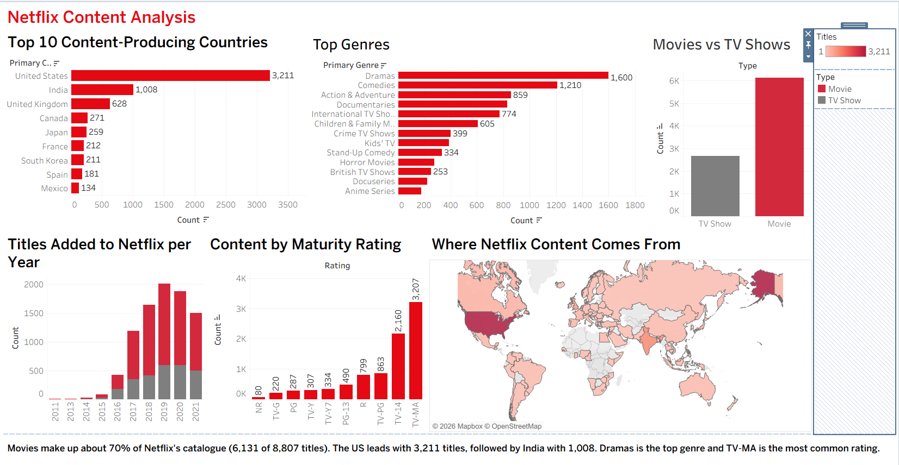

# Netflix Content Analysis: My First Tableau Dashboard

**Live dashboard:** [View on Tableau Public](https://public.tableau.com/app/profile/rahul.ballidav/viz/nteflixdashboard/NetflixDashboard)

> **Note:** This is my first dashboard built in Tableau. I made it as a beginner to learn the tool from scratch (connecting data, calculated fields, charts, maps and dashboard layout). My later Tableau projects build on what I learned here.

---

## Project Overview

An exploratory dashboard on Netflix's catalogue, built to answer a few simple questions:

1. How is the catalogue split between Movies and TV Shows?
2. How many titles were added to Netflix each year?
3. Which countries produce the most content on the platform?
4. Which genres and maturity ratings are the most common?

## Dataset

- **Source:** Netflix Movies and TV Shows (`netflix_titles.csv`) from Kaggle
- **Size:** 8,807 titles (6,131 Movies and 2,676 TV Shows)
- **Key columns:** type, title, country, date_added, release_year, rating, duration, listed_in (genres)

## Tools Used

- Tableau Public (Desktop)
- Kaggle (data source)

## Dashboard Contents

| Chart | What it shows |
|---|---|
| Movies vs TV Shows | Split of the catalogue by content type |
| Titles Added per Year | Growth of the catalogue by year added, split by type |
| Top 10 Content-Producing Countries | Countries with the most titles |
| Top Genres | Most common genres |
| Content by Maturity Rating | Number of titles per rating (TV-MA, TV-14, etc.) |
| Where Netflix Content Comes From | World map shaded by number of titles |

## Data Preparation (done inside Tableau)

- **Date Added Clean:** `date_added` was imported as text, so I converted it to a real date with `DATEPARSE("MMMM d, yyyy", TRIM([date_added]))`.
- **Year Added:** extracted from the clean date with `YEAR()` and converted to a dimension so years display as categories.
- **Primary Country:** many titles list several countries, so I took the first one with `TRIM(SPLIT([country], ",", 1))`.
- **Primary Genre:** same approach on `listed_in`, to get one genre per title.
- **Geographic role:** assigned the Country/Region role to Primary Country so Tableau could draw the map.
- **Null handling:** excluded blank dates and blank countries from the relevant charts.
- **Bad rating values:** three rows had a duration (for example "74 min") in the `rating` column, so I excluded them from the ratings chart. I also excluded ratings with only a handful of titles.
- **Years with very few titles:** excluded from the yearly chart to keep it readable.

## Key Findings

- **Movies dominate:** about 70% of the catalogue is Movies (6,131 of 8,807 titles).
- **Fast growth:** titles added per year rose sharply from 2016 and peaked in 2019. 2021 is lower because the data covers only part of that year.
- **United States leads** with 3,211 titles, followed by India (1,008) and the United Kingdom (628).
- **Dramas** is the top genre (about 1,600 titles), followed by Comedies (about 1,210).
- **TV-MA** is the most common rating (3,207 titles), followed by TV-14 (2,160).

## Tableau Features Practiced

- Connecting to a CSV file
- Calculated fields (`DATEPARSE`, `TRIM`, `SPLIT`, `YEAR`)
- Dimensions vs measures, and converting a measure to a dimension
- Bar charts, stacked bars, and filled map
- Sorting, filtering and excluding values
- Colour customisation (Netflix red and grey palette)
- Mark labels, tooltips and legends
- Building and arranging a multi-sheet dashboard
- Publishing to Tableau Public

## Limitations

- Only the **first** country and **first** genre of each title are counted, so titles with multiple countries or genres are under-counted for the others.
- The data is a **snapshot** and does not include viewership, so it shows what is in the catalogue, not what people watch.
- 2021 is a **partial year**, so it should not be compared directly with full years.
- A few titles have no country or date and are left out of the related charts.

## What I Learned

- How Tableau reads data types and why a text date has to be converted before it can be charted.
- How to split multi-value text columns into a single usable category.
- Why data cleaning decisions (nulls, bad rows, partial years) change what a chart appears to say.
- That layout, colour and clear titles matter as much as the chart itself.

## Author

**Rahul Ballidav**
GitHub: [rahulmatrix10](https://github.com/rahulmatrix10)
